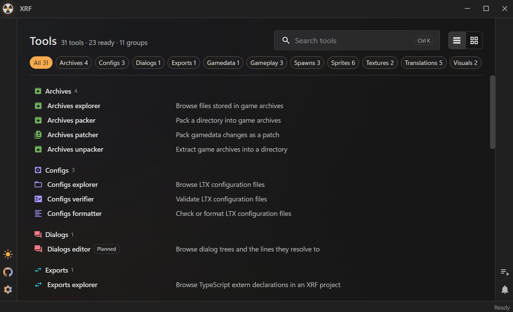

# Tools Application

The XRF tools application is a Tauri desktop app with a Rust backend and a React UI. Use it for interactive inspection
and one-off data operations; use the [Tools CLI](../cli/cli.md) when the task must be repeatable, scripted, or run in
CI.

It groups its work into editors for archives, configs, dialogs, script exports, equipment icons, levels, spawns, and
translations. The level decompiler and level compiler run the same code as the CLI's
[`level decompile`, `level build` and `level compile`](../cli/level.md), with progress, cancelling between steps, and a
list of what each run left out; the level compiler builds a scene and compiles it with the steps and light quality
chosen in one run, refusing the whole run before the build writes anything where the compile would refuse, the light's,
the details' and the AI map's rays traced on the GPU chosen in the renderer settings, or on the CPU. Which screens and
actions each one currently offers changes with the application, so the application is the authority on that, not this
book. Some routes are read-only or prototype workflows, and several write files — packing, unpacking, formatting, and
saving spawn data all overwrite their targets.

Keep a backup before writing over game data.

## Source

- `xrf-tools/bin/xrf-app`: Tauri backend plugins and commands;
- `xrf-tools/bin/xrf-app/ui`: React routes, pages, stores, and components;
- `xrf-tools/crates/*`: reusable parsers, verifiers, packers, and project readers.
